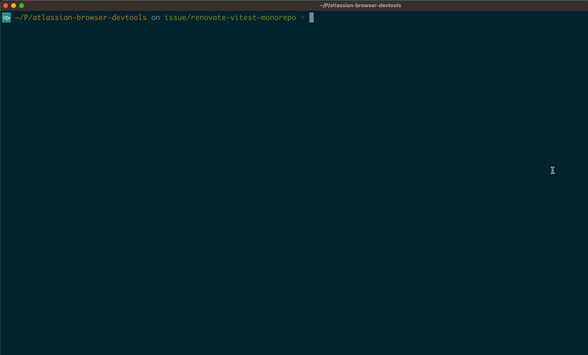
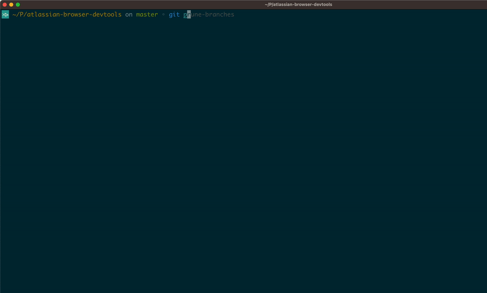
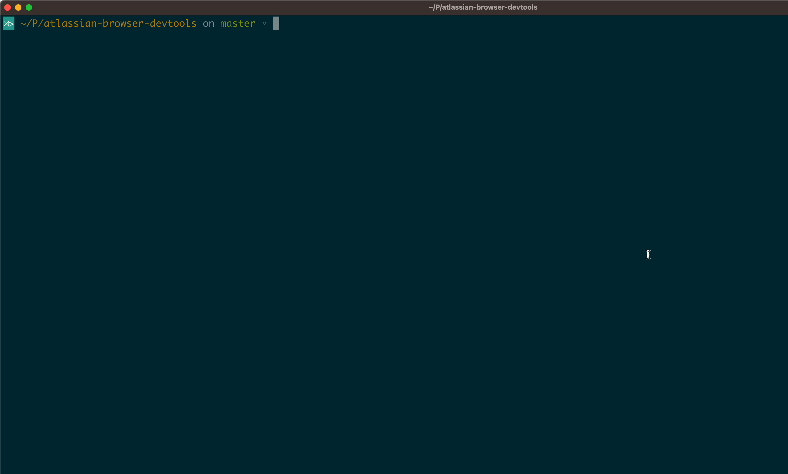

# GIT helpers

`git switch-branch` & `git prune-branches` & `git builds` & `git issues`

A few extra commands that will improve your developer productivity.

## Installation

```
npm install -g git-switch-branch

git config --global alias.switch-branch '!git-switch-branch'
git config --global alias.prune-branches '!git-prune-branches'
git config --global alias.builds '!git-builds'
git config --global alias.issues '!git-issues'
```

### Credentials

> This step is optional and required only if you plan to use the `git builds` or `git issues` commands.

Before you use the `git builds` or `git issues` commands, you need to create a config file that includes access tokens:

1. Create a config file under your user directory:

```sh
touch ~/.atl-config
```

2. Edit the file with your editor of choice and provide access tokens:

    ```sh
    code ~/.atl-config
    ```

    Example content:

    ```env
    # Bitbucket Cloud setup
    # If the projects you are working is using Bitbucket Cloud use this part
    # 1. Create a new app password with the READ permissions to the repository and pipelines https://bitbucket.org/account/settings/app-passwords/
    BITBUCKET_CLOUD_TOKEN=<<APP-PASSWORD>>
    # 2. Bitbucket username that can be found on https://bitbucket.org/account/settings/
    BITBUCKET_CLOUD_USERNAME=maciej-adamczak

    # Bitbucket Data Center setup
    # If the projects you are working is using Bitbucket Data Center use this part
    # 3. Base URL to Bitbucket DC instance
    BITBUCKET_DC_URL=https://my-bitbucket.instance.com
    # 4. HTTP Access Token with the READ permissions.
    # You can generate the token from your account profile: Manage account -> HTTP access token -> Create token
    BITBUCKET_DC_TOKEN=<<HTTP-ACCESS-TOKEN>>

    # GitLab setup
    # If the projects you are working is using GitLab use this part
    # 5. GitLab Personal Access Token with the API permissions.
    # You can generate the token from your account profile: Profile Preferences -> Access Tokens -> Add new token
    # Select the "read_api" scope
    # https://docs.gitlab.com/ee/user/group/settings/group_access_tokens.html
    GITLAB_TOKEN=<<PERSONAL-ACCESS-TOKEN>>

    # Jira setup
    # If you want to use the git issues command to view your Jira issues
    # 6. Base URL to your Jira instance (e.g. https://your-domain.atlassian.net)
    JIRA_URL=https://your-domain.atlassian.net
    # 7. Your Jira email address
    JIRA_EMAIL=your-email@example.com
    # 8. Jira API token. Generate from: https://id.atlassian.com/manage-profile/security/api-tokens
    JIRA_TOKEN=<<JIRA-API-TOKEN>>
    ```

> Why do you need to generate and save access tokens?

The password and access tokens are only required if you want to use the `git build` or `git issues` alias.

## Usage

### Switch branch

Interactively switch local GIT branch with a better DX:

```
git switch-branch
```



### Prune local branches

Interactively prune unused local GIT branches:

```
git prune-branches
```



### Builds

Shows build status for your local GIT branch:

```
git builds
```



### Issues

Shows Jira issues assigned to the current user:

```
git issues
```

Filter issues by status:

```
git issues --status="In Progress"
```
